# shell-risk

shell-risk scans shell scripts for the patterns that turn into incidents: piping a download into a shell, `eval` of expanded data, `rm -rf $DIR/` that deletes `/` when the variable is empty, world-writable permissions, setuid bits, predictable files in `/tmp`, secrets written into the script and certificate checks turned off. It is one Bash file with no dependency, so it runs on a fresh server, in a CI job or in a container.



**Live demo:** https://jvch0512.github.io/shell-risk/ (Synthetic scripts.)

Bash 4+, no dependencies. The demo page is rendered from the tool's `--tsv` output by `scripts/site.py` (Python 3, only needed to regenerate the page).

## Use

```bash
bin/shell-risk examples
bin/shell-risk ./scripts --tsv
bin/shell-risk deploy.sh --fail-on high       # exit 1 on any high finding or worse
```

A directory is scanned recursively for `*.sh`, `*.bash` and any file whose first line is a `sh`, `bash`, `dash`, `zsh` or `ksh` shebang. `.git` is skipped.

| Rule | Severity | What it catches |
|---|---|---|
| SHL001 | high | `curl` or `wget` piped into a shell |
| SHL002 | high | `eval` of a line that expands a variable or a command substitution |
| SHL003 | medium | `chmod 777`, `a+rwx` or `o+w` |
| SHL004 | high | `rm -rf` on a variable without a `${VAR:?}` guard |
| SHL005 | medium | output redirected to a fixed file in `/tmp` instead of `mktemp` |
| SHL006 | medium | `curl -k`, `curl --insecure` or `wget --no-check-certificate` |
| SHL007 | high | a password, secret, token or key assigned a literal value |
| SHL008 | high | a password piped into `sudo -S` |
| SHL009 | high | setuid or setgid bits set with `chmod` (`4755`, `u+s`) |
| SHL010 | medium | `sh -c` or `bash -c` running a variable |
| SHL011 | low | a Bash script with no `set -e`, `set -u` or `set -o pipefail` anywhere |
| SHL012 | critical | `rm -rf /` or `--no-preserve-root` |

See [examples](examples) and [docs/sample-output.txt](docs/sample-output.txt).

## Limits

- It matches lines with regular expressions. It does not parse shell, so a pattern inside a heredoc or a quoted string can be reported.
- Only full-line comments are skipped. A trailing `# comment` is scanned with the code.
- Multi-line commands are checked line by line.
- [ShellCheck](https://www.shellcheck.net/) finds correctness bugs. shell-risk looks at security patterns and is meant to complement it.

## Where it fits

Reviewing install scripts, deploy scripts and CI helpers before they reach production.

## Tests

```bash
make test    # A Bash test script with temp-file fixtures: every rule on bad and good lines, comments, directory scanning, shebang detection, odd file names, exit codes
```

MIT.

## Code scanning (SARIF)

`scripts/tsv2sarif.py` converts the `--tsv` output into SARIF 2.1.0, so findings show up in GitHub code scanning:

```sh
bin/shell-risk examples --tsv | python3 scripts/tsv2sarif.py --tool shell-risk --prefix examples > results.sarif
```

Upload `results.sarif` with `github/codeql-action/upload-sarif`. Severities map to SARIF levels (critical and high to error, medium to warning, low and info to note) and to a `security-severity` score.

## Validated on real data

This tool was run on public corpora and the false positives it produced were fixed. Corpus, counts and bugs found are in [docs/validation.md](docs/validation.md).
